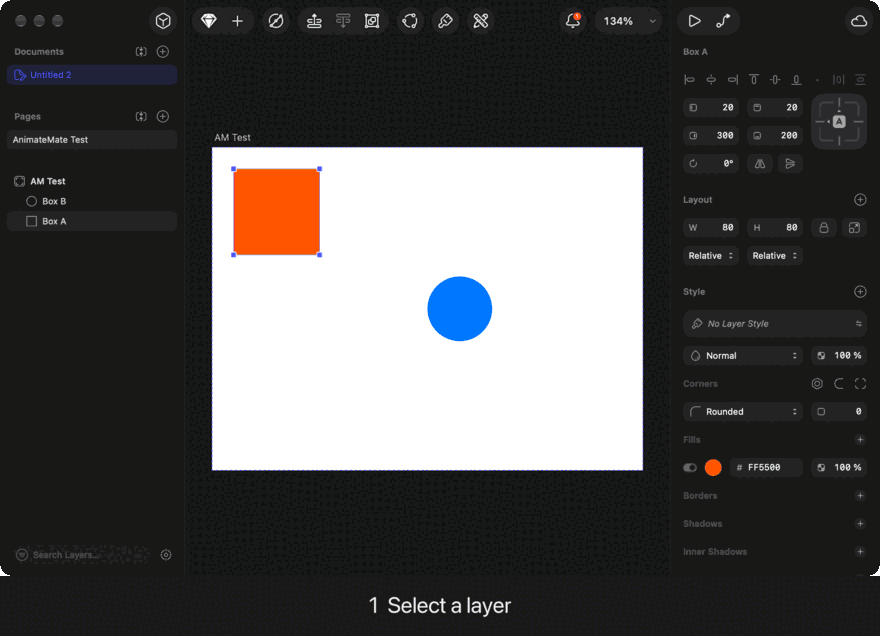
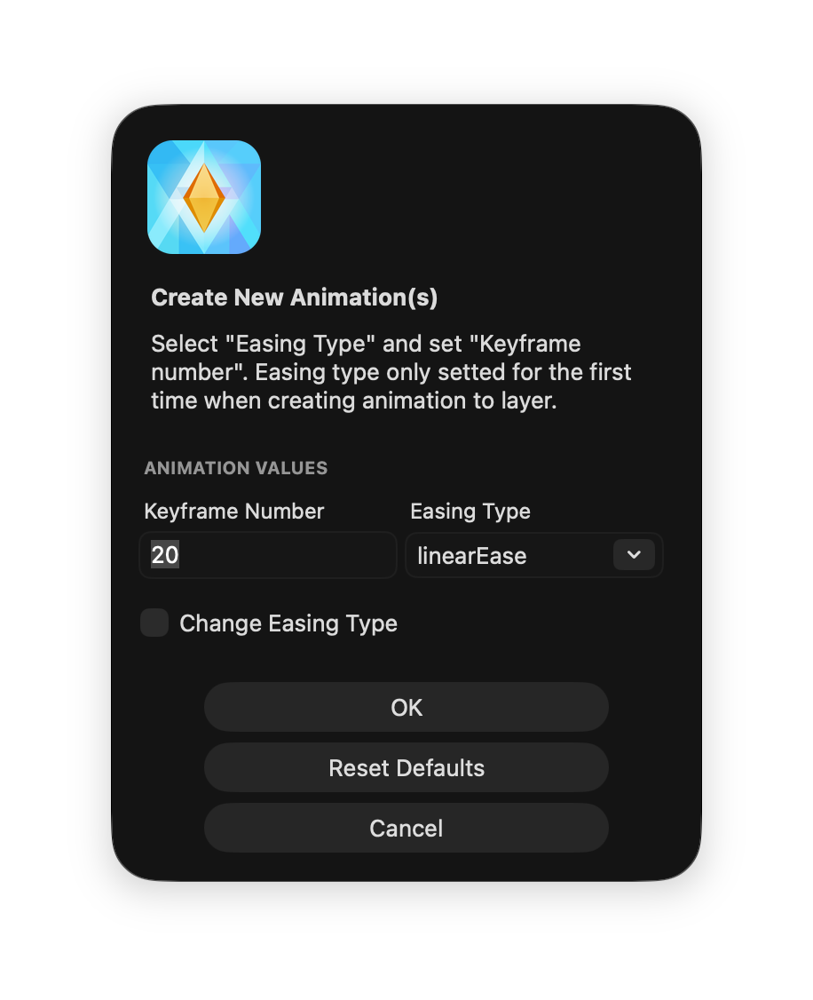
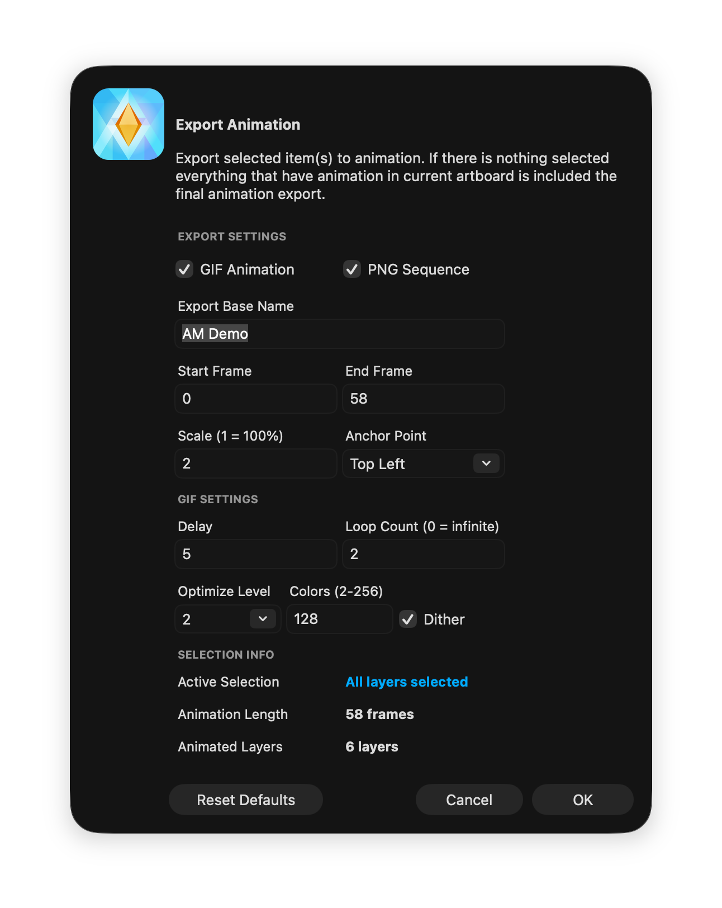
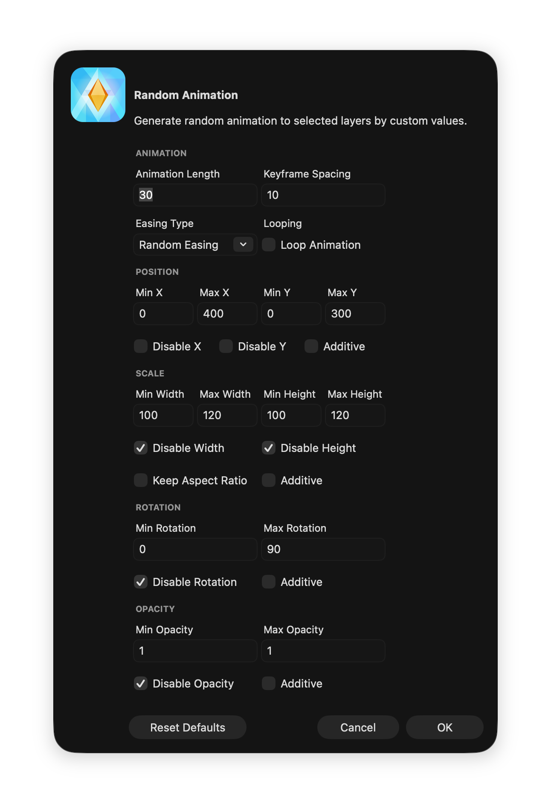
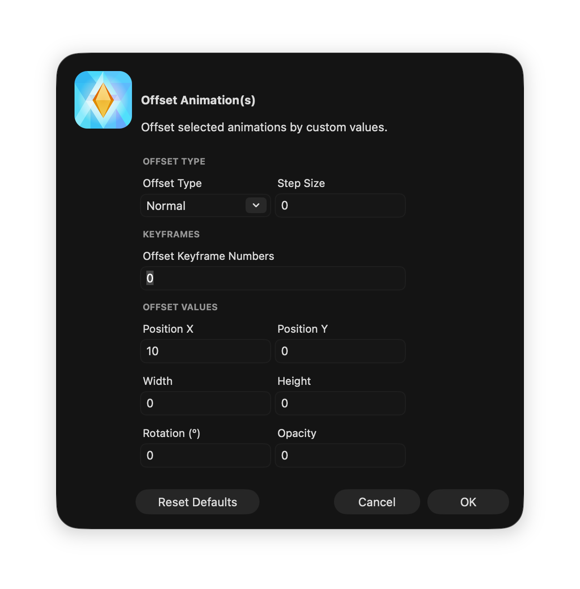
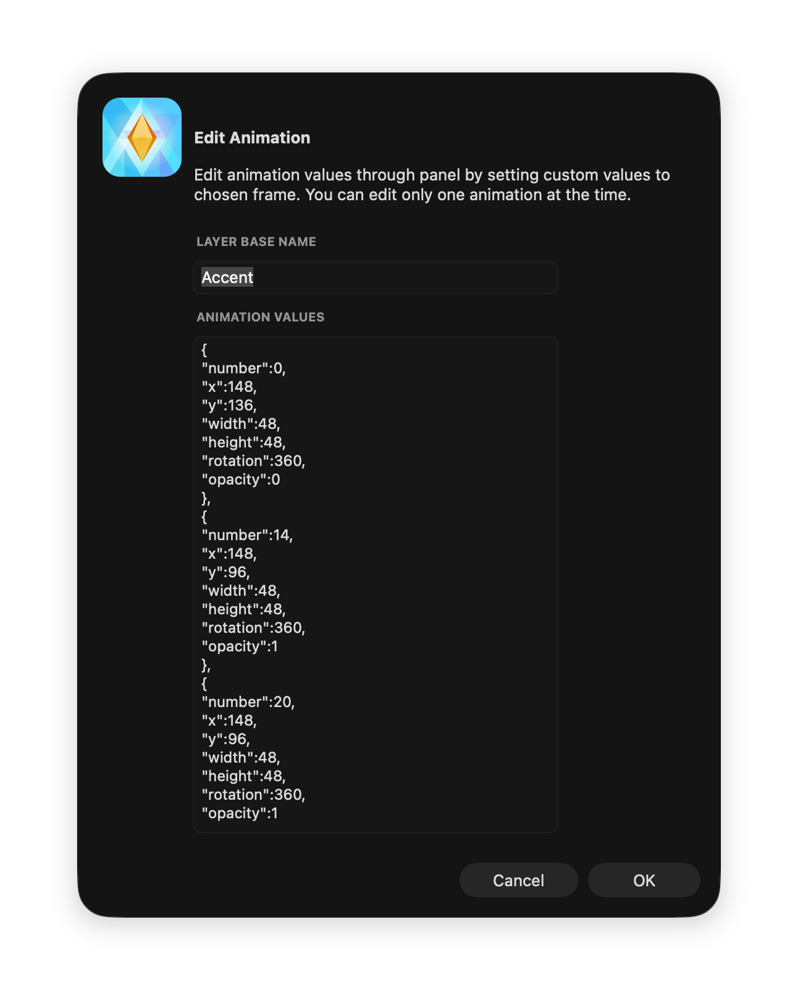

AnimateMate Plugin For Sketch
=============================

> **This is a fork.** AnimateMate was created by [Creatide](http://creatide.com) (Sakari Niittymaa)
> in [Creatide/AnimateMate](https://github.com/Creatide/AnimateMate), which is no longer maintained and is archived.
> This fork, maintained by [@isaiasmac](https://github.com/isaiasmac), keeps the plugin working on current Sketch
> (tested on Sketch 2026.3.1, Apple Silicon). All credit for the original plugin goes to its author.
> See [Changes in this fork](#changes-in-this-fork).
>
> Please report issues and send pull requests to [isaiasmac/AnimateMate](https://github.com/isaiasmac/AnimateMate),
> not to the original repository.

#### "Create your animations directly in Sketch using AnimateMate."


*Made and exported with AnimateMate in Sketch 2026.3.1.*

<br><br>

##### *Haha, is this joke or what?! Why the heck do I need animation tools in Sketch.*

You know feeling when you just need a simple animation for your awesome concept and you realize that it's a huge process to move all assets into some other application? That’s a lot of hassle! Like this example.

<br>


##### *I Know the Feeling!*

That's why I created AnimateMate in order to produce and export simple animations straight out of Sketch. It's not exactly rocket science, but it can lighten your workflow in some cases. 
So let the game begin!


## Install

Copy **`AnimateMate.sketchplugin`** to **Sketch** plugins folder. 

> Easiest way to go into your Sketch plugin folder:<br>
**Plugins > Manage Plugins > Reveal Plugins Folder**

GIF export needs [Gifsicle](https://www.lcdf.org/gifsicle/) installed on your system
(it is no longer bundled with the plugin):

```bash
brew install gifsicle
```

The plugin looks for it in `/opt/homebrew/bin`, `/usr/local/bin` and `/opt/local/bin`.
PNG sequence export works without it.


## Changes in this fork

- **Loads on Apple Silicon.** The bundled Intel-only `gifsicle` binary made Sketch reject the
  whole plugin ("not compatible with your computer's CPU architecture"). It was removed; the
  system install is used instead.
- **Works with Sketch artboards-as-frames.** `MSPage.currentArtboard()` and `MSArtboardGroup`
  no longer exist and artboards are now `MSLayerGroup`s. The active artboard is resolved from
  the selection (or the only artboard on the page), and artboards are told apart from groups
  via `page.artboards()`.
- **Year-based Sketch versions.** The Sketch version is parsed as a number, so checks like
  `>= 41` work again with versions such as `2026.3.1`.
- **Export scale works again.** PNG frames (and the GIF made from them) are rendered at the
  scale set in the Export dialog, e.g. `2` for @2x.
- **Safer GIF export.** `sips` and `gifsicle` are run directly with argument lists instead of
  through a shell, so export names and folders with spaces, quotes or apostrophes work.
- **Layers are always restored.** If rendering fails midway, layers go back to their original
  position, size, rotation and opacity instead of staying on the last rendered frame.
- **Cleaner export.** No temporary folder is left behind when the export folder dialog is
  canceled, the GIF file name uses the rendered frame range, and a message confirms PNG-only
  exports.
- **Readable dialogs in dark mode.** Field labels use the system text color instead of
  fixed black, which was almost invisible on dark dialogs.
- **Test harness for development** in [`dev/`](dev/README.md).


## How to Use

The basic workflow: add a keyframe, change the layer, add another keyframe, export.



The original author's video walks through more of the basics (recorded with an older Sketch):
[AnimateMate Basics on YouTube](https://www.youtube.com/watch?v=bDm_c4wPBkc).

Keyframes are stored in the layer name, e.g. `Box A{:linearEase;0,20,20,80,80,360,1;20,...}`,
so animations travel with your Sketch file.

You could run into a situation when you're wondering why it's working this or that way... This plugin does not convert your **Sketch** to a fully featured animation software :) However, it'll help you in many simple cases, but if you need more complex animations you should consider some other animation tools. **AnimateMate** was made for creating simple animations at least for now, we'll see how it'll develop in the future...

#### Shortcuts

Command               | Shortcut                              | Description
:-------------------  | :------------------------------------ | :----------------------------------------------------
**Create Animation**  | *`ctrl` + `option` + `cmd` +* **`K`** | Create new animation / keyframe to layer.
**Offset Animation**  | *`ctrl` + `option` + `cmd` +* **`O`** | Offset animated and/or keyframe values.
**Random Animation**  | *`ctrl` + `option` + `cmd` +* **`G`** | Generate random animation to selected layers.
**Edit Animation**    | *`ctrl` + `option` + `cmd` +* **`L`** | Edit layer animation values in ordered text view.
**Delete Animation**  | *`ctrl` + `option` + `cmd` +* **`D`** | Delete animation from selected layer(s).
**Return Keyframe**   | *`ctrl` + `option` + `cmd` +* **`R`** | Return selected keyframe values to layer(s).
**Export Animation**  | *`ctrl` + `option` + `cmd` +* **`A`** | Export your animation to PNG or GIF format.
**Reverse Keyframes** | *`ctrl` + `option` + `cmd` +* **`B`** | Reverse keyframes in single or multiple animations.

#### Dialogs

<p>


</p>
<p>



</p>


## Examples

Here are a couple examples that are made using **AnimateMate** plugin in **Sketch**. They were made by the original author with
earlier Sketch versions. The original author's site, [AnimateMate.com](http://animatemate.com), had more info and examples.


## Known Bugs to Fix

* [x] Export scaling option doesn't work after Sketch 41 version.

## Roadmap & Feature Ideas

* [x] Remember values in some input fields in dialogs
* [ ] Visual timeline editor
* [ ] Improve groups workflow
* [ ] Text animations
* [ ] Randomize exist keyframe values
* [ ] Select a layer by keyframe numbers
* [ ] Anchor helper object into the workflow
* [x] Reverse keyframes
* [ ] Spread keyframes to a given time
* [ ] Multiple easing types in animations
* [x] More options to GIF exporting


## Collaboration & Feedback

Issues and pull requests are welcome in this fork: [isaiasmac/AnimateMate](https://github.com/isaiasmac/AnimateMate/issues).
The original repository is archived and no longer accepts contributions.


## About

I think **Sketch** is super useful in many design tasks. But while using Sketch and as well many other graphic design softwares I was always longing for the basic level of animation tools. Usually it's only the basic move-, rotation-, scale- or transparency animations that needed to visualise something simple.

I think most of the graphical design sofwares should include at least some very basic level of animation tools. Like in Photoshop I've nowadays found many good uses for animation tools. Too often it would be hard work to transfer all assets to other software just for creating simple animations. Still, it doesn't need to be such a complex system...

### Author

**AnimateMate** was originally made by [Creatide](http://creatide.com) *([Sakari Niittymaa](http://sakari.niittymaa.com))*.
The text in this section and in [About](#about) is the original author's.

This fork is maintained by [@isaiasmac](https://github.com/isaiasmac).

> Creatide is not a company nor a big factory. It's a single Designer who also loves coding and improving workflow. I create tools for my personal usage in order to relieve my design process, so every tool is used by myself. Some of those tools end up being released to the public under this name and domain.

> Working as a designer makes your come up with different ideas on how your workflow could be improved. My approach: when you got an idea for a specific tool, create it, then you have it. That's what Creatide is all about.

### Contributors

Thank you all for your contributions. Special thanks to these people for writing code:

[@headlessme](https://github.com/headlessme)

### Licence

The MIT License (MIT)
Copyright (c) 2017 [Creatide](http://creatide.com) *([Sakari Niittymaa](http://sakari.niittymaa.com))*<br>
Fork changes Copyright (c) 2026 [isaiasmac](https://github.com/isaiasmac)

### Used Libraries & Tools

- [Gifsicle](https://github.com/kohler/gifsicle)
- [Robert Penner's Easing Functions](http://robertpenner.com/easing/)
